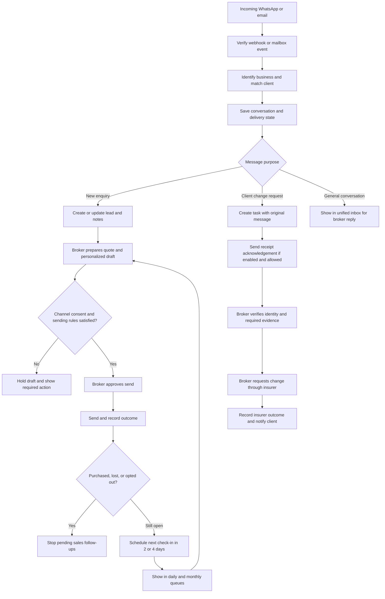
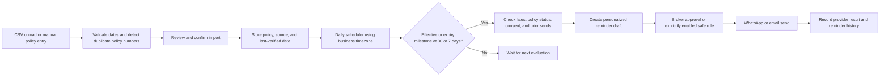
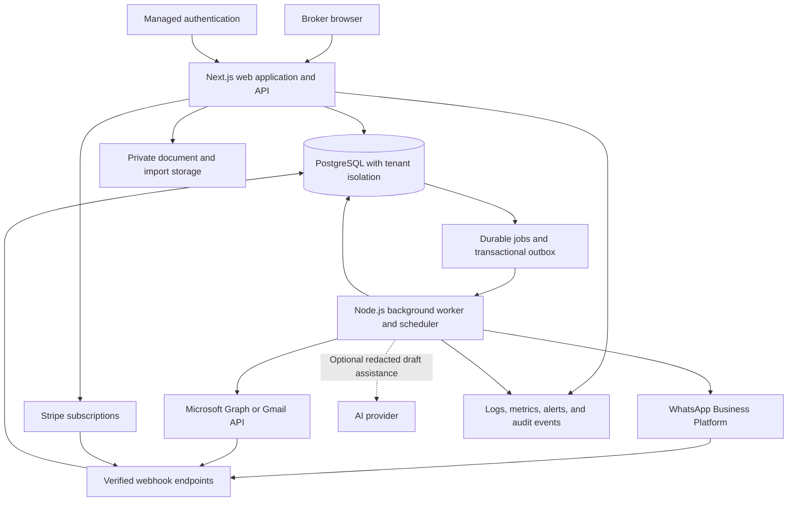

# MapleDesk: workflows, architecture, stack, and budget

> Historical multi-business proposal. The current client-first scope and lower-cost deployment are in [SINGLE-BROKER-LAUNCH.md](SINGLE-BROKER-LAUNCH.md).

Planning proposal · October 17, 2026 · All estimates in Canadian dollars, before tax.

These are scope-based engineering estimates, not vendor quotes. Current provider prices and access/verification requirements must be confirmed before a fixed-price contract. The existing prototype demonstrates interactions; production authentication, integration, automation, billing, and security still need implementation.

## 1. Recommended scope

Launch a multi-tenant subscription product for independent Canadian insurance brokers. One customer business is a tenant, with its own users, clients, policies, settings, and billing. Begin with one pilot brokerage.

The production MVP includes:

- Secure sign-in, business workspaces, owner/broker roles, and tenant isolation.
- Client records, lead statuses, notes, search, monthly follow-up views, and 2/4-day scheduling.
- WhatsApp Business Platform integration and one email provider: Microsoft 365 or Gmail, selected during discovery.
- Unified conversations, personalized drafts using confirmed client context, delivery/error states, and opt-out handling.
- CSV policy import and manual entry with effective/expiry dates and configurable 30/7-day reminder rules.
- Client change-request tasks, acknowledgements, notes, ownership, and resolution tracking.
- Monthly subscription billing, entitlements, onboarding, and audit events.
- A broker-reviewed pilot, monitoring, backups, and an operational runbook.

Direct insurer portal integrations, a second email provider, mobile apps, voice/call ingestion, automatic policy amendments, insurer underwriting/quoting, and full historical WhatsApp migration are outside this MVP.

Client names remain unchanged. Month, insurance type, status, next-follow-up date, and purchase state become searchable fields.

## 2. Main workflow

The acknowledgement confirms receipt only. It must never claim that coverage, a date, an address, or a DOB has already been changed.

## 3. Policy reminder workflow

Each reminder has an idempotency key containing tenant, policy, event type, milestone, and relevant policy date. A retry must not send a duplicate. Policy date changes invalidate obsolete scheduled work. Display data freshness so stale imports do not look like live insurer data.

## 4. Architecture

Use a modular monolith with shared domain services for CRM, conversations, policies, tasks, billing, and integrations. Run the web/API and background worker as separate processes. Do not run durable schedules inside browser sessions or short-lived HTTP requests.

Key reliability controls:

- Verify provider signatures and subscription notifications; deduplicate incoming provider event IDs.
- Save inbound events durably, acknowledge them promptly, and process asynchronously.
- Use transactional outbox records for sends and jobs; pg-boss provides durable execution, retries, and concurrency control.
- Retry transient failures with backoff; surface exhausted jobs for broker/operator action.
- Recheck consent, lead status, policy dates, and integration connection state immediately before sending.
- Treat provider acceptance, delivery, read status, and failure as separate outcomes where supported.
- Keep email subscription renewals, mailbox sync cursors, WhatsApp rate limits, and expired OAuth connections visible and recoverable.
- Store dates and timezone context explicitly and test daylight-saving transitions.

Principal records: tenants, users/memberships, clients, contact methods, consent records, leads, policies/import batches, conversations, messages/provider events, follow-up rules/jobs, change requests, integration accounts, subscriptions, and audit events.

## 5. Proposed stack

| Layer | Recommendation | Purpose |
|---|---|---|
| Web and API | Next.js, React, TypeScript | Shared types and one application for browser views and business endpoints |
| UI | Tailwind CSS and accessible component primitives such as shadcn/ui | Professional, responsive interfaces with reusable forms and dialogs |
| Database | PostgreSQL on Amazon RDS, with Drizzle migrations | Relational client/policy data and transaction support |
| Durable work | pg-boss plus a persistent Node.js worker | Scheduling, retries, reminder processing, and webhook jobs without a separate Redis service |
| Identity | Amazon Cognito or an equivalent managed identity provider | Sign-in and account recovery; application still enforces tenant membership and roles |
| WhatsApp | Meta WhatsApp Cloud API through a provider adapter | Official business messaging integration |
| Email | Microsoft Graph first if the pilot uses Microsoft 365; Gmail API if it uses Google Workspace | OAuth-based mailbox reading, subscriptions/sync, and sending from the connected mailbox |
| Payments | Stripe Billing and Customer Portal | Subscription checkout, renewals, cancellations, and plan management |
| Hosting | AWS ECS Fargate for web and worker; RDS and S3 in Canada Central | Consistent regional deployment with long-running workers |
| Security/operations | Secrets Manager, KMS, CloudWatch, backups, infrastructure as code | Credential protection, monitoring, recovery, and deployment |
| Testing/delivery | Vitest, Playwright, GitHub Actions | Domain tests, tenant isolation tests, end-to-end workflows, and CI |
| Optional AI | Pluggable text-generation adapter | Draft assistance only; deterministic code controls dates, permissions, and sending |

Tenant isolation needs enforcement beyond adding a tenant_id column. Resolve tenant membership server-side, scope all data access, use PostgreSQL RLS with a non-bypass application role where appropriate, and test cross-tenant access. Use private S3 objects, short-lived access links, audit trails, and retention/deletion rules.

Canadian hosting does not guarantee that all external messaging, mailbox, payment, telemetry, or AI providers process data exclusively in Canada. Validate contracts and data flows. Have qualified counsel confirm applicable Canadian privacy and messaging obligations, including PIPEDA/provincial requirements and CASL where relevant.

## 6. Integration constraints to validate before committing

### WhatsApp

Validate the brokerage's number, business ownership, verification, available onboarding/coexistence path, and consent records. The broker's current personal-app contact list and chat history must not be assumed to sync automatically. Outbound sends must respect the customer-service window and approved-template requirements applicable at launch. A business-initiated reminder may require a template even when the CRM has a personalized draft. Replies stop or reschedule automation as configured; opt-outs suppress applicable future sends.

### Email

Support one provider first. Use OAuth scopes necessary for the selected workflow, protect refresh tokens, support disconnect/revocation, and handle mailbox webhook renewals and missed-event recovery. Microsoft tenant consent policies and Google's verification/security assessment requirements depend on scopes and deployment model. Confirm them early; external verification/audit cost and delay are not included in the estimates below.

### Insurers

For Manulife and each other insurer, establish whether broker API access, an approved partner integration, or usable exports exist. Start with reviewed CSV/manual imports. Do not promise automated portal login, scraping, or amendments before access and permission are confirmed. MFA, portal changes, commercial agreements, or absent APIs can materially alter feasibility and cost.

## 7. One-time build estimate

Assumed planning rate: **CAD 100 per engineering hour**. These estimates assume one email provider, one WhatsApp business account per tenant, CSV/manual policy import, a focused web product, and a small supervised pilot. They are not vendor or fixed-price quotes.

| Work package | Hours |
|---|---:|
| Discovery, UX, workflow and access validation | 35–50 |
| Authentication, business workspaces, roles, tenant boundaries | 45–65 |
| CRM, policies, imports and follow-up views | 60–90 |
| WhatsApp, one email integration, unified conversations | 80–120 |
| Reminder jobs, acknowledgements and request tasks | 60–90 |
| Subscription billing and plan access | 25–40 |
| QA, security checks, deployment and pilot feedback | 75–110 |
| **Total** | **380–565** |

Engineering subtotal: **CAD 38,000–56,500**. Add a 20% planning contingency: **CAD 45,600–67,800**, rounded to a **CAD 46,000–68,000 production MVP budget**. A small independent team might deliver this in roughly **10–14 weeks**, after provider access is available; external review can extend elapsed time.

### Lower-cost pilot

Budget **CAD 15,000–22,000** for a **4–6 week single-broker pilot** with secure sign-in, basic clients/policies, manual/CSV import, one email account, a WhatsApp account, simple review-before-send drafts/reminders, and a narrow change-request workflow. This assumes straightforward provider onboarding. It excludes self-service subscription billing, robust multi-business isolation/onboarding, expanded automation, and production-scale support. It is a reduced scope, not the same SaaS for less money.

If the pilot cannot fit this budget after access validation, reduce integration scope or increase budget before starting. Reusable pilot work should count toward the MVP; do not simply add both budgets together. Re-estimate remaining work at the pilot checkpoint.

### Later additions

- Second email provider: approximately **CAD 5,000–10,000**, subject to consent/verification requirements.
- Approved insurer integration: planning allowance **CAD 8,000–25,000 per insurer** only where a documented usable API exists; insurer fees/contracts are additional. No reliable fixed estimate without discovery.
- Advanced AI suggestions/classification: approximately **CAD 3,000–8,000** plus usage and evaluation. This is optional; start with editable templates and structured client context.

Excluded: taxes, provider fees, external legal advice, external security assessments, insurer commercial arrangements, complex historical migration, and ongoing support. Agency rates above CAD 100/hour increase the estimate proportionally. The current static mockup should not be priced as completed production integration work.

## 8. Monthly running estimate

Small launch scenario: approximately 5–20 broker businesses, tens of thousands of stored client/policy records, low concurrent usage, and a few thousand outbound messages a month. This is a capacity/cost planning assumption, not a benchmark.

| Item | CAD/month planning allowance |
|---|---:|
| Web application and persistent worker | 150–350 |
| PostgreSQL and backups | 100–250 |
| Storage, logs, monitoring, and authentication | 50–150 |
| Small miscellaneous services and optional AI | 20–150 |
| **Base platform allowance** | **320–900** |

A separate staging environment, high availability, larger log volumes, attachment storage, and heavier usage raise this allowance. WhatsApp/BSP charges, email-provider licences or fees, and Stripe processing/billing fees are additional and must be estimated from current quotes and actual usage. Do not quote messaging fees as a universal fixed amount: destination, message category, provider route, and current pricing matter.

Human maintenance/support is a separate **CAD 800–2,000/month** allowance at 8–20 hours/month and the assumed rate. A practical initial operating reserve is therefore **CAD 1,200–3,000/month plus messaging, payment, and mailbox charges**. Acquisition, sales, and founder time are excluded.

Subscription prices in the mockup are illustrative. Set commercial pricing only after estimating per-broker message volume, support burden, target margin, and onboarding effort.

## 9. Delivery checkpoints

1. **Validate access and scope:** pilot mailbox provider, WhatsApp number/onboarding path, insurer exports, consent process, data handling, and usage assumptions.
2. **Approve workflow:** lead states, cadence/stop rules, task lifecycle, acknowledgement language, and effective/expiry reminder policies.
3. **Run a supervised pilot:** approved sample data first, then a limited real-client rollout with controlled send permissions.
4. **Review evidence:** delivery reliability, duplicate-send prevention, timezone correctness, tenant isolation, recovery, and broker usability.
5. **Launch subscription MVP:** only after real integration paths and operational responsibilities are proven.

Before a fixed quote, obtain: the pilot's mailbox provider, number of brokers/businesses at launch, expected WhatsApp/email volume, insurers and export/API access, and desired pilot budget.
