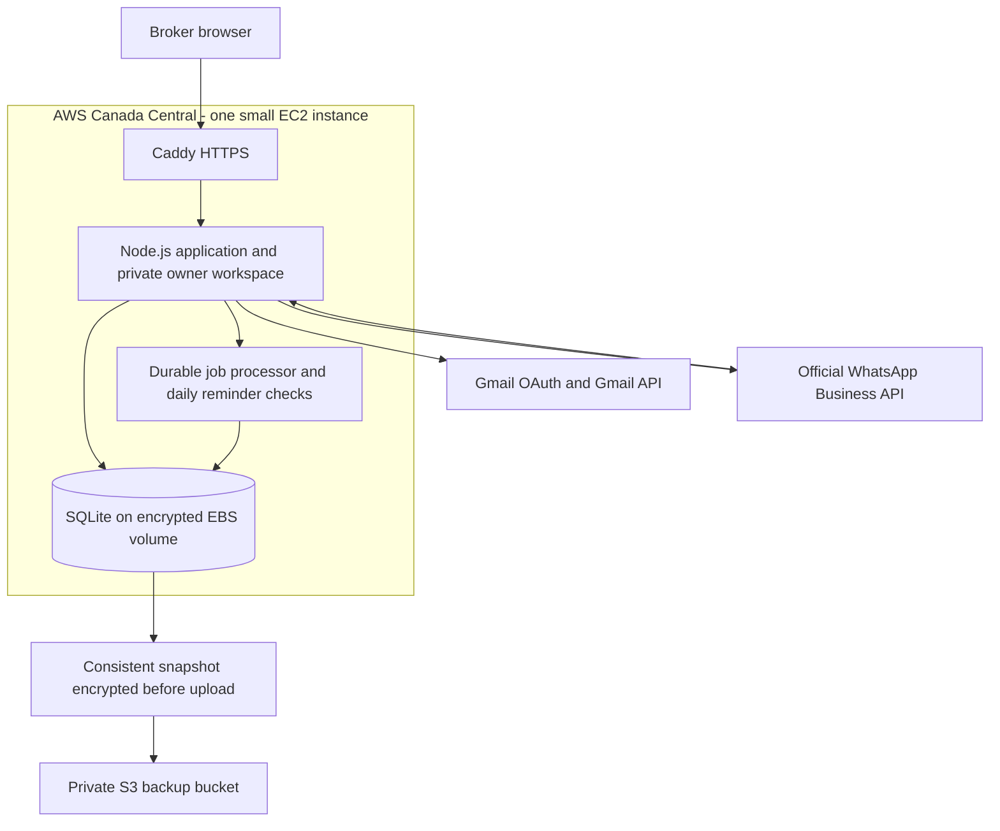

# Low-cost, single-broker launch

This supersedes the multi-business launch scope in PRODUCT-PLAN.md. The client uses Gmail and the WhatsApp Business phone app and prefers to keep the phone app. No AWS account, domain, or Google Cloud project is connected yet.

## What is implemented

- A private owner workspace with password sign-in, server sessions, CSRF/origin checks, login throttling, and authenticator MFA support (required by production configuration).
- SQLite-backed contacts, consent evidence, opt-outs, leads, 2/4-day follow-up dates, monthly filters, policies, messages, tasks, and audit events.
- Gmail OAuth with PKCE/state and encrypted refresh tokens, initial recent inbox/sent import without historical auto-replies, incremental polling, replies, and queued outgoing email.
- Official Meta webhook verification, event deduplication, text-message ingestion, delivery updates, sending adapters, 24-hour service-window checks, and configured approved-template support.
- Receipt-only acknowledgements for rule-detected changes, task ownership by the single broker, notes and statuses. Ambiguous messages still need manual inbox review.
- Daily effective/expiry 30/7-day reminder drafts, broker approval, stale-policy checks, durable jobs, and conservative handling of unknown send outcomes.
- CSV import with preview, email-based contact matching, duplicate detection, and atomic confirmation.
- Encrypted integration secrets and backup files; private S3 backup upload and a verified restore command.
- Container/HTTPS configuration, Terraform for a small AWS deployment, backup scheduling, and CI checks.

These are implemented code paths, not a claim of real provider connectivity. Tests use synthetic accounts and controlled provider responses. No real messages have been sent, no insurer accessed, and no AWS resources created.

## Architecture

Keep the existing plain-JavaScript interface and Node.js backend rather than paying for a React/Next.js rewrite. SQLite is appropriate for this single-instance pilot; keep one process/replica. There is no RDS, Redis, paid AI, public signup, subscription checkout, or multi-business architecture in this release. When multiple businesses become a real requirement, plan PostgreSQL, business-scoped access, onboarding and billing as a separate migration. This is not currently tenant-isolated SaaS.

The earlier prototype remains at `/demo` and in `mockups/`. Its sample conversations and subscription screens do not enable those features in the real workspace.

## Cost decisions

Indicative initial infrastructure allowance: **CAD 40–100/month**, before tax and excluding provider fees. This is an estimate for a small instance, 20 GB storage, public IPv4, small backups and monitoring; confirm current Canada Central pricing before creating anything. Free-tier/trial eligibility is not assumed. A domain is additional, commonly budgeted at **CAD 15–40/year**, but obtain an actual registrar quote.

WhatsApp charges, any coexistence/BSP provider subscription, Google verification/security assessments, mailbox licences, and human support are separate. A USD 50 AWS budget alert is included as an editable example; alerts are delayed notifications, not a hard spending cap. AWS credits do not imply all external services are free.

The previous development estimate represented paid human engineering effort. It was not an AWS setup fee. Implementation here does not require paying an agency that amount, but development, testing, provider onboarding and ongoing operations still take work. No fixed project fee or delivery date is being charged or promised by this document.

## WhatsApp: keep the phone app now; assess automation separately

The implemented manual fallback prepares a `wa.me` draft in the existing WhatsApp app. The broker presses Send there, then explicitly confirms the send in the CRM to advance a follow-up. No provider delivery receipt is claimed, no inbound app history is synchronized, and this is not automatic WhatsApp sending. It requires recorded consent and respects CRM opt-outs. This route can be used while API/coexistence onboarding is unresolved.

### Official API path

The WhatsApp Business phone app alone does not supply an API token. Before connecting the existing number:

1. Establish the client's ownership of the number and Meta business assets.
2. Check current official WhatsApp Business App coexistence eligibility and whether it requires a supported onboarding/BSP route for this account/region.
3. Check actual provider fees and whether phone-app-originated messages/history appear in that route. The current adapter handles ordinary Cloud API message/status webhooks; it does not implement all provider-specific coexistence history or app-echo event formats.
4. If a BSP is required, validate its webhook and authentication contract; add an adapter rather than assuming its payloads match Meta Cloud API.
5. Test with an approved test number and sample data before touching the existing number.

Do not deregister, migrate, disconnect or replace the client's phone number without a reviewed migration decision. If coexistence is unavailable, agree on a separate API number or a migration exception first. That decision remains unresolved; none of these files prove account eligibility.

## Gmail: connect the existing mailbox

Create a Google Cloud project controlled by the client or an agreed operator, enable the Gmail API, configure consent and a web OAuth client, and register exactly:

`https://YOUR_DOMAIN/api/integrations/gmail/callback`

Set GOOGLE_CLIENT_ID, GOOGLE_CLIENT_SECRET, GMAIL_ADDRESS and DATA_KEY securely on the server. Sign in to MapleDesk and use Connections → Connect Gmail. Only the configured Gmail address can connect.

The application requests gmail.readonly and gmail.send. These scopes can trigger Google's verification/restricted-scope assessment requirements depending on usage and publication. Testing-mode refresh tokens for Gmail scopes can expire after seven days; do not treat repeated test-user consent as a permanent production integration. Determine personal-use exceptions or production verification requirements with Google before committing to launch cost.

The initial sync imports at most 20 recent inbox/sent messages from seven days, flags obvious change requests, and does not auto-reply to historical messages. Incremental polling is approximately every five minutes. Expired history cursors cause a visible gap warning and recent re-import without old automatic replies; the owner must review Gmail for missed older messages. Attachments are not stored or processed in this pilot; non-text messages are flagged for review in the original channel.

## Launch sequence and gates

1. Continue local validation in mock-delivery mode with synthetic records.
2. Create client-controlled AWS, domain/DNS, Google Cloud and Meta business access. Use MFA. Supply secrets through host/cloud settings; never through chat or GitHub.
3. Review the Terraform plan and current prices. Deploy only after the concrete resources and budget are accepted.
4. Configure HTTPS, owner MFA, Gmail OAuth and test-number WhatsApp. Keep ALLOW_LIVE_SENDS=false while checking connections and imports.
5. Review consent wording, classification misses, retention/deletion process, reminder freshness, and any applicable privacy/messaging obligations.
6. Enable live sending explicitly for supervised sample recipients who have agreed to testing. Verify Gmail and WhatsApp receipt, provider delivery statuses, opt-outs, duplicate prevention, and expiry reminders.
7. Verify an encrypted S3 backup and a restore in a separate directory. Configure an external uptime check and test the alert/backup-failure notification path.
8. Only then introduce a small set of real client records. Expand after the broker approves the pilot behavior.

Current blockers: cloud/account/domain ownership, provider credentials/consent, WhatsApp phone-app coexistence decision, real provider acceptance tests, and off-instance backup/restore validation in AWS. These do not prevent local implementation, but they prevent calling the system deployed or production-ready.
