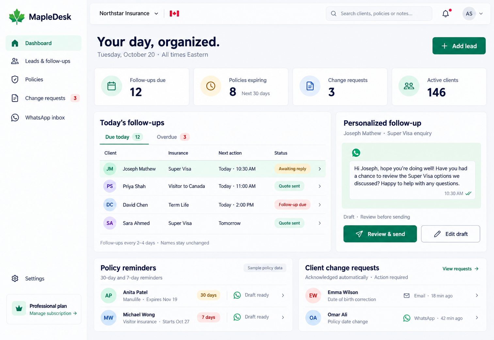

# MapleDesk design concept

A proposed subscription workspace for Canadian insurance brokers, covering lead follow-ups, personalized WhatsApp drafts, policy date reminders, and client change requests.

- [PDF mockup](MapleDesk-Mockup.pdf)
- [Standalone HTML mockup](MapleDesk-Mockup.html): download using GitHub's **Download raw file** button, then open in your browser. The image is embedded and works offline.

This is a visual concept with sample data. Messaging, insurer integrations, billing, and automation have not been implemented.
